# Experimentopia 🧪 – das Versuchslabor für die Hosentasche (Klasse 3–10)

Viele Versuche kann man zu Hause nicht machen: Säure und Lauge mischen, Knallgas zünden, einen Hammer auf dem Mond fallen lassen,
ein Klavier mit dem Flaschenzug heben. In Experimentopia geht das – auf sieben Inseln, mit **Blubb**, einem neugierigen Laborkolben,
dessen Flüssigkeit mit seiner Laune die Farbe wechselt (Recherche: `../docs/RECHERCHE.md`).

**Version 0.1.0 vom 16.11.2026** · 68 Versuche · 20 Geräte im Freien Labor · 12 Reaktionsgleichungen · 13 Abzeichen

## So forscht man in Experimentopia

Jeder Versuch folgt dem Forscher-Kreislauf (Predict – Observe – Explain):

1. **Rätsel** – Blubb erzählt, was er vorhat.
2. **Vermuten** – mit „Wie sicher bist du?“ (🤔 / 🙂 / 😎). Eine falsche Vermutung kostet **nie** etwas: Sie wird als 💡 Aha-Moment gefeiert.
3. **Ausprobieren** – im Labor selbst tun: eintauchen, Gewichte setzen, Seil ziehen, Kabel legen, Tropfen zugeben, Atome zählen, heizen, pusten, fallen lassen.
4. **Auflösung** – Vermutung und Ergebnis nebeneinander.
5. **Blubb erklären** – Blubb versteht es nicht und fragt „Warum?“. Lernen durch Lehren (Protégé-Effekt).
6. **Merksatz + Knobelfrage** – das Wissen auf eine neue Lage übertragen.

Sterne: ⭐ Versuch gemacht · ⭐ Blubb gleich richtig erklärt · ⭐ Knobelfrage gelöst. Das **Forscherbuch** sammelt Vermutungen, Ergebnisse und Merksätze
und zeigt, wie gut man sich selbst einschätzt („Wenn du dir ganz sicher warst, lagst du in 4 von 5 Fällen richtig“).

## Die Inseln

| Insel | Versuche (Auswahl) | Klasse |
|---|---|---|
| 🌊 Wasserinsel | Holz vs. Nagel, Riesenkerze, nackte Orange, Ei im Salzwasser, Knetboot, Eis in Spiritus, Dichteturm, Archimedes | 3–7 |
| ⚖️ Kraftwerk-Insel | Kind gegen Papa auf der Wippe, Gleichgewicht, Hebelgesetz, feste/lose Rolle, Klavier mit Flaschenzug, schiefe Ebene | 3–8 |
| ⚡ Blitzinsel | Leitertest, Bleistiftmine, UND/ODER-Schalter, Reihe/Parallel, Kurzschluss, Ohmsches Gesetz, Magnete, Pole | 3–9 |
| 🌋 Chemie-Vulkan | Rotkohl-Zaubersaft, pH-Wert, Neutralisation, pH-Sprung, Verdünnen, Natron-Ballon, Knallgas, Magnesium, Rost, Fotosynthese … | 3–10 |
| 🔥 Feuer & Eis | Was schmilzt zuerst, Heizkurve mit Teilchenblick, Mischtemperatur, Badewasser, glühendes Eisen | 3–8 |
| 🌈 Licht & Klang | Licht mischen, Farbfilter, Prisma (echte Brechung), Gläser-Xylofon, Röhren-Orgel, Stimmgerät, „Alle meine Entchen“, Saite | 3–8 |
| 🚀 Fallturm-Insel | Kugel gegen Feder, Papier-Trick, Vakuumröhre, Fallzeit, Mond, Pendel, Sekundenpendel | 3–10 |

## Korrekt gerechnet

Alle richtigen Antworten werden aus Modellen in `core/model` **berechnet**, nicht hingeschrieben, und in `CatalogTest`/`PhysicsTest` geprüft:
Auftrieb (ρ-Vergleich, Eintauchtiefe), Hebelgesetz, Flaschenzug (Goldene Regel), Stromkreise (Reihe/Parallel, Kurzschluss),
pH aus [H⁺]−[OH⁻] mit Kw, Atomzählung aller Reaktionen, begrenzender Stoff beim Natron-Ballon, Richmann-Mischungsregel, Heizkurve mit Schmelz- und
Verdampfungswärme, Fall mit Luftwiderstand (numerisch) und ohne, exakte Pendeldauer (elliptisches Integral), Röhren f = c/(4L),
Prisma mit Cauchy-Brechzahl und Snellius. Ziele, die man einstellen muss (z. B. 0,2 A, pH 2, 880 Hz, T = 2 s), sind mit den Reglern erreichbar.

## Frei und Pro

Vorbereitet wie bei Raumlicht, aber **ausgeschaltet** (`Pro.ENABLED = false`): Heute ist alles frei. Später frei: die ganze Wasserinsel,
von jeder Insel die ersten 3 Versuche, Rätsel des Tages, Forscherbuch, 6 Geräte im Freien Labor. Der „Forscher-Pass“ (Einmalkauf, kein Abo) öffnet alles.
Eingeschaltet wird erst, wenn es einen Bezahlweg gibt.

## Bildschirme

| Start mit Blubb | Inselpfad | Rätsel | Vermuten + Sicherheit |
|---|---|---|---|
| 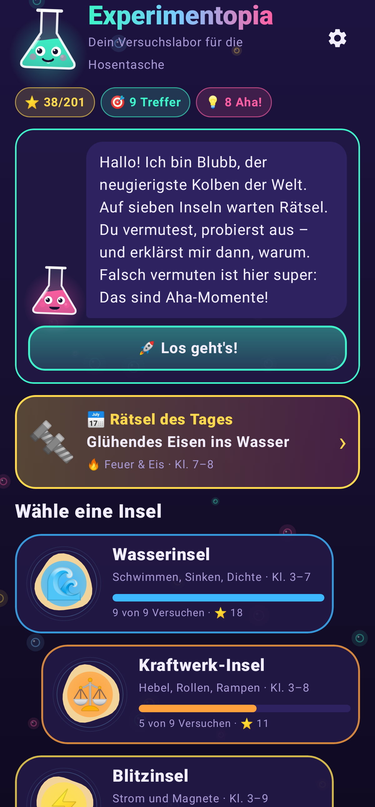 |  |  |  |
| Ausprobieren | Aha-Moment | Blubb erklären | Geschafft |
|  |  | 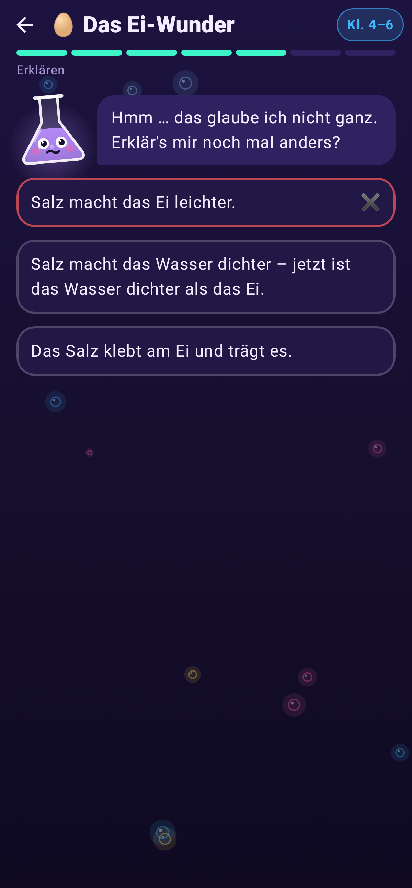 |  |
| Dichteturm | Wippe | Flaschenzug | Lampen in Reihe |
|  | 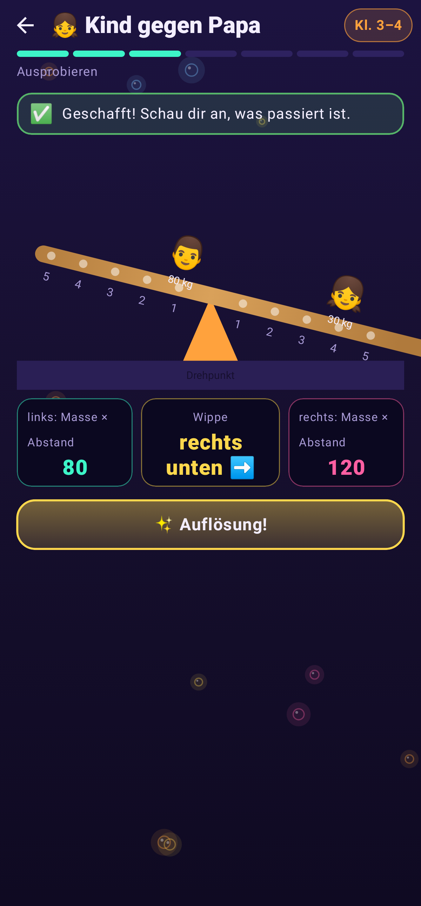 |  | 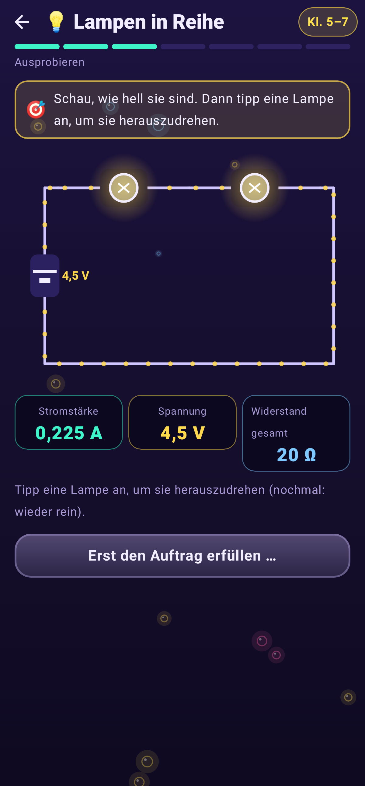 |
| Leitertest | Ohmsches Gesetz | Magnet | Rotkohl-Saft |
| 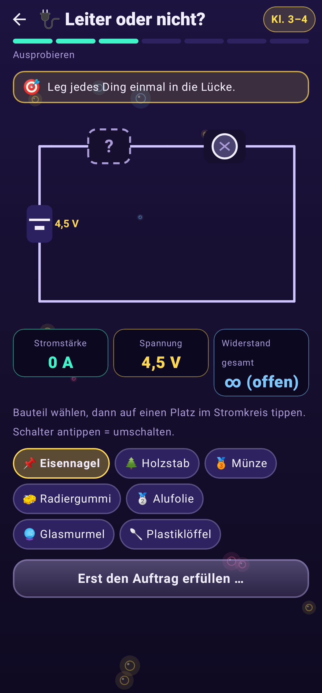 |  |  | 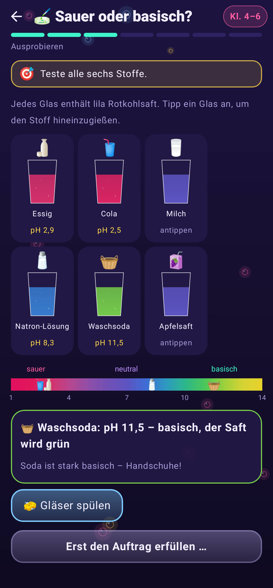 |
| pH-Sprung | Atom-Baukasten | Natron-Ballon | Heizplatte |
|  | 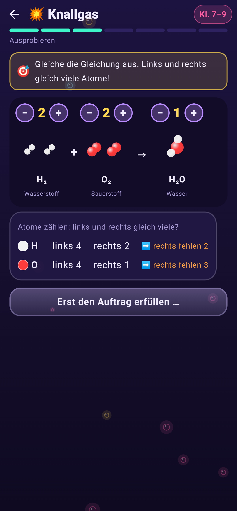 |  |  |
| Teilchenblick | Mischtemperatur | Licht mischen | Prisma |
|  |  |  |  |
| Lied spielen | Stimmgerät | Fallturm | Pendel |
|  |  | 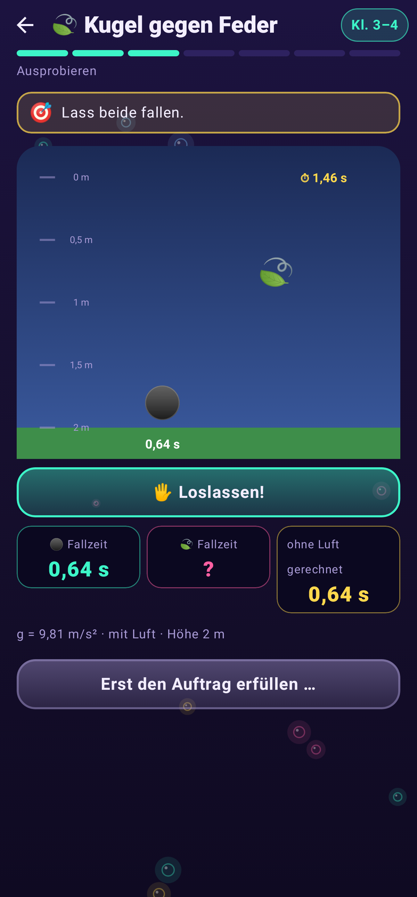 |  |
| Freies Labor | Eigene Werte | Freier Stromkreis | Forscherbuch |
| 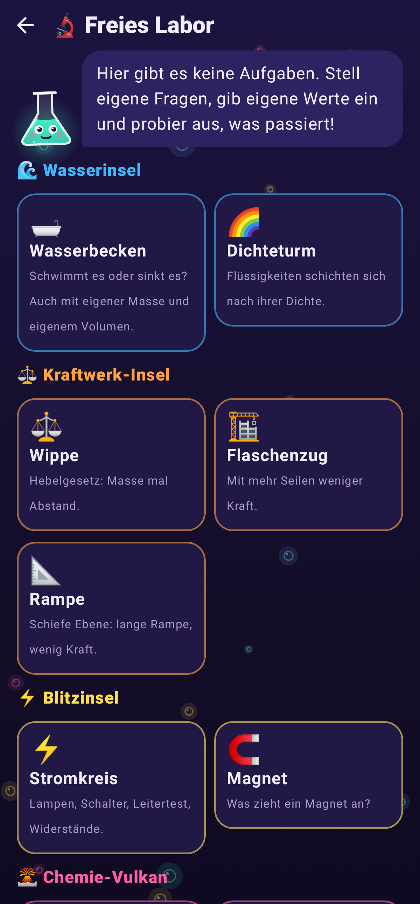 |  |  | 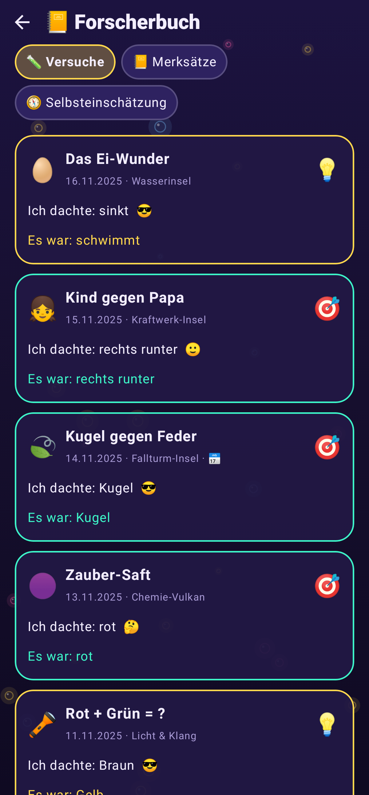 |
| Selbsteinschätzung | Abzeichen | Einstellungen | Forscher-Pass (vorbereitet) |
| 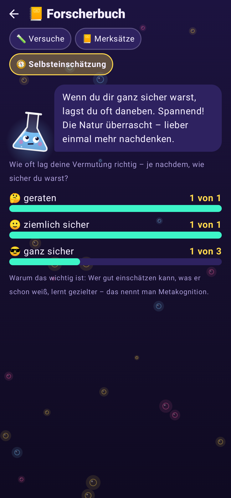 | 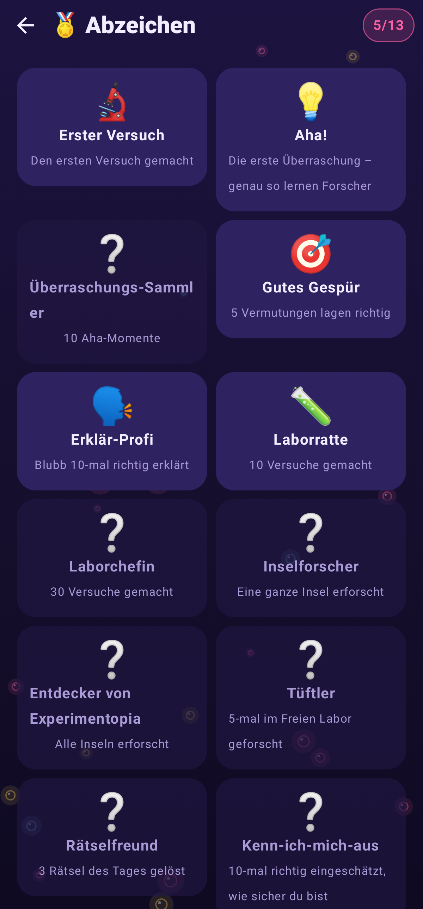 |  |  |

## Bauen

```
./gradlew :core:model:test :core:data:testDebugUnitTest      # Modelle und Speicher
./gradlew :app:testGithubDebugUnitTest --tests '*ScreenshotTest*'   # Bildschirmfotos nach screenshots/
./gradlew assembleGithubRelease                              # APK (Fassung mit eigenem Update-Knopf)
```

Releases baut `.github/workflows/experimentopia-release.yml` (Tag `experimentopia-v<Version>`), Text aus `CHANGELOG.md`.

Datenschutz: kein Konto, keine Werbung, keine Käufe, keine Kamera, kein Mikrofon. Gespeichert wird nur auf dem Gerät. Ins Internet nur für die Update-Prüfung (abschaltbar).
