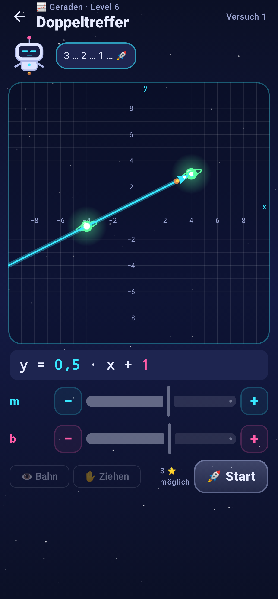

# Kurvenflug – Mathe & Physik im All (Klasse 5–10)

Du steuerst eine Raumsonde – die Flugbahn ist eine Formel, die du selbst einstellst. Das Rechnen ist die Spielsteuerung
selbst, kein Quiz zwischen zwei Spielphasen (Recherche: `../docs/RECHERCHE.md`, weitere Ideen: `../docs/APP-IDEEN.md`).

Inhalte: Koordinaten (Kl. 5–6), Geraden (Kl. 7–8), Parabeln (Kl. 9), schräger Wurf auf Erde/Mond/Mars (Physik).

## So funktioniert Kurvenflug
- Die Sonde fliegt auf der eingestellten Bahn: `(x | y)`, `y = m·x + b`, `y = a·(x − d)² + e` oder Wurf mit `α`, `v`, `g`.
- Regler mit −/+ und Schieber, die Formel zeigt live die Zahlen – in derselben Farbe wie der Regler.
- Nur der Anfang der Bahn ist sichtbar: wer rechnet, trifft beim ersten Versuch (3 ⭐). „Ganze Bahn“ hilft, gibt aber höchstens 2 ⭐.
- Volt gibt nach Fehlversuchen konkrete Rückmeldung mit Zahlen, ab dem zweiten Fehlversuch einen Rechentipp.
- Alle Level werden in Tests mit ihrer Lösung durchgeflogen (lösbar, Lösung liegt auf dem Regler-Raster, Startwerte lösen nicht,
  alle Energiezellen erreichbar). Die Wurfweite wird gegen `v²·sin(2α)/g` geprüft.

## Bildschirme
| | | |
|---|---|---|
|  |  |  |
|  |  |  |
|  |  |  |
|  | | |

## Aufbau
- `core/model` – reine Kotlin-Logik: Flugbahnen, Wurfphysik, Kollisionen, Level, Rückmeldungen, Update-Prüfung (Unit-Tests)
- `core/data` – Fortschritt (Room, Bestwerte bleiben), Einstellungen
- `app` – Compose-Oberfläche, Volt, im Code erzeugte Geräusche, Updater

## Bauen & Ausliefern
```
export ANDROID_HOME=/opt/android-sdk
./gradlew test            # Tests + Bildschirmfotos (screenshots/)
./gradlew assembleRelease
```
Ausliefern: `versionCode`/`versionName` in `app/build.gradle.kts` erhöhen, Abschnitt in `CHANGELOG.md`, pushen.
GitHub baut, signiert (gleicher Schlüssel wie der Wissensgarten) und veröffentlicht `kurvenflug-v<Version>` unter Releases.
Die App findet die neue Version selbst (Einstellungen → App-Update).
