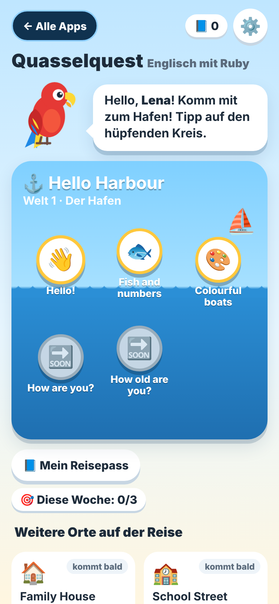
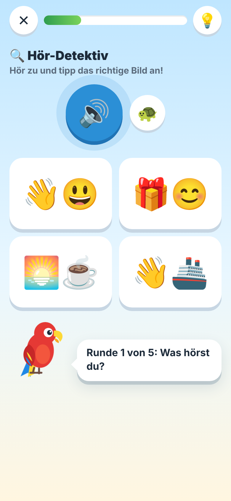
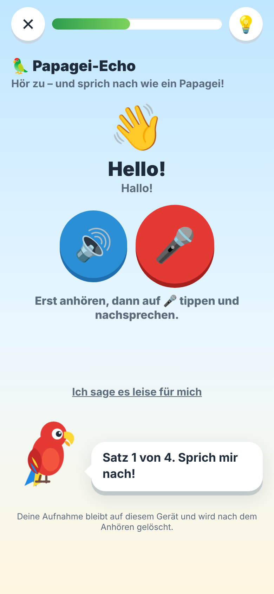
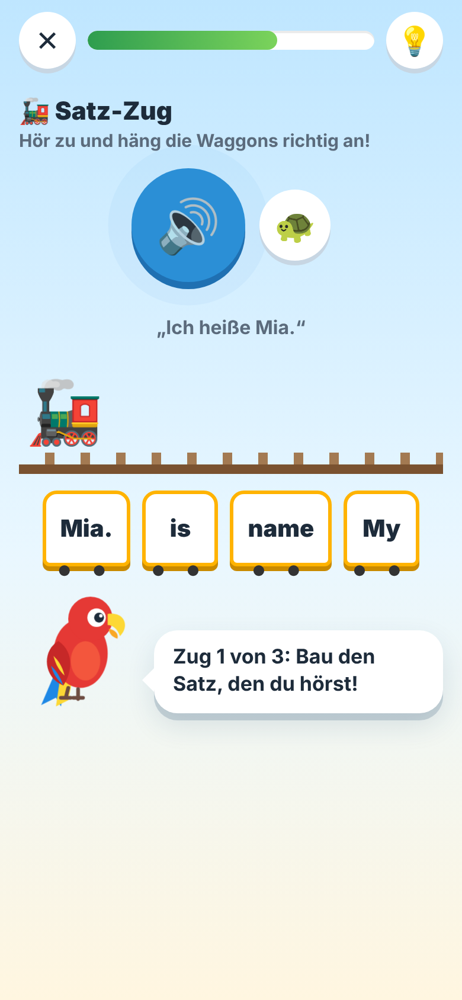
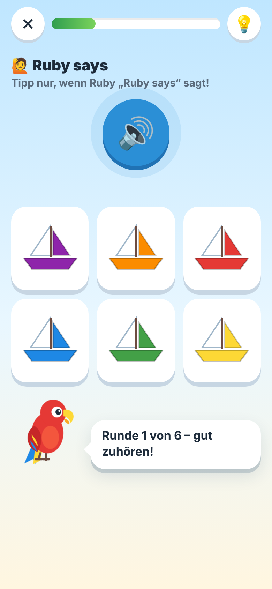
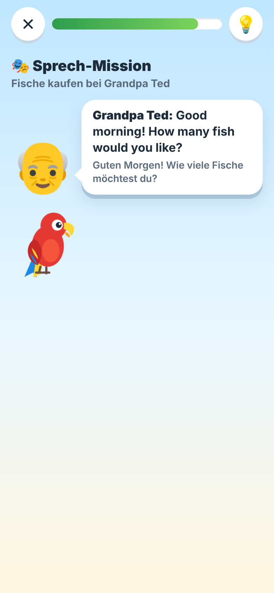
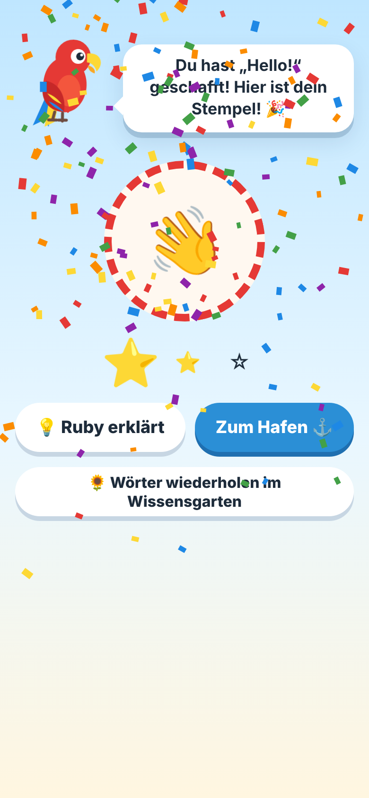
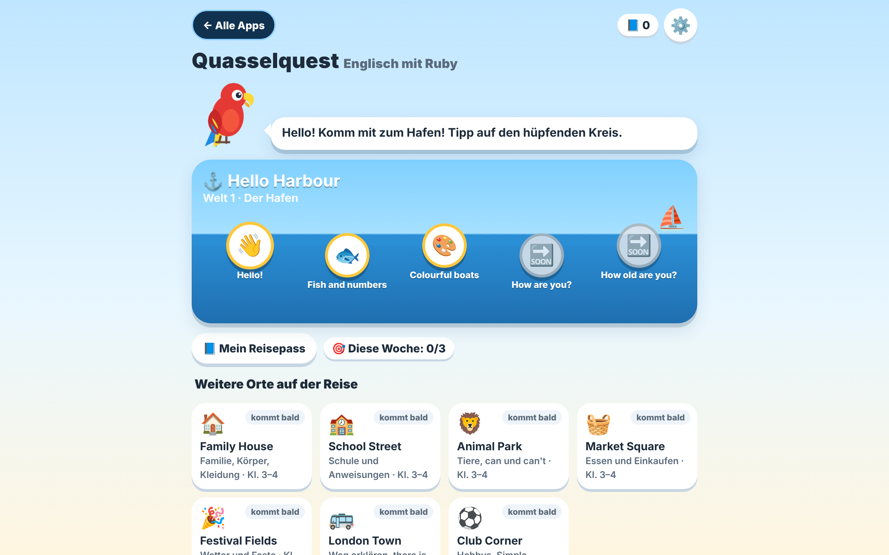

# Quasselquest – Englisch sprechen, hören, spielen · Klasse 3–6

WebApp (PWA) in schlichtem JavaScript – ohne Kotlin/Wasm, damit iPhone und iPad keine weißen Seiten zeigen.
Konzept: [`KONZEPT.md`](KONZEPT.md) · Meldungen: [`MELDUNG_AN_LEITSTAND.md`](MELDUNG_AN_LEITSTAND.md) · Änderungen: [`CHANGELOG.md`](CHANGELOG.md)

**Stand: Version 0.1.0 vom 18.11.2026 – Prototyp „Hello Harbour“** (3 Episoden, 5 Spielarten). Name „Quasselquest“ von Marcel am 19.11.2026 entschieden.
Test: https://quasselquest-test.mathenachhilfe-online.com (Branch `quasselquest-test`, Workflow `quasselquest-web-test.yml`) · Live nur durch den Leitstand.

## Aufbau
- `webapp/` – die fertige WebApp (wird so ausgeliefert, kein Build-Schritt)
  - `content.js` Inhalte (Welten, Episoden, Spiele, Missionen, „Ruby erklärt“)
  - `audio.js` Töne (im Code erzeugt), Stimme (englische Gerätestimme, nur lokale Stimmen), Mikrofon (nur auf Knopfdruck), Spracherkennung (optional, bevorzugt auf dem Gerät)
  - `app.js` Oberfläche und Spiele · `app.css` Aussehen und Animationen · `sw.js` Offline + Update
- `tools/vertonen.py` – vertont alle festen Sätze mit freien Piper-Stimmen und prüft jede Datei mit einer Spracherkennung (Whisper); Ergebnis in `HOERPRUEFUNG.md`, Lizenzen in `LIZENZEN.md`
- `tools/test-inhalt.mjs` – Inhalts- und Logiktests: `node --test tools/test-inhalt.mjs`
- `tools/web-start.mjs` – Durchspielen in Chromium und WebKit (iPhone 13, iPad, Handy, PC), offline, Eltern-Tor, „← Alle Apps“: `node tools/web-start.mjs [--fotos]`

## Bildschirmfotos
| Hafen | Hör-Detektiv | Papagei-Echo | Satz-Zug |
|---|---|---|---|
|  |  |  |  |

| Ruby says | Sprech-Mission | Stempel | PC |
|---|---|---|---|
|  |  |  |  |

Hinweis: In der Testumgebung gibt es keine englische Gerätestimme; dann zeigt die App den Satz als Text („lies den Satz“). Auf iPhone/iPad/Android spricht die en-GB-Stimme des Geräts.
