# Raumlicht – Oberstufen-Mathe als Lichtshow (ab Klasse 11 bis zum Abitur)

Du bist Lichtdesigner:in. Laser sind Geraden, Glasscheiben und Leinwände sind Ebenen, die Drohne **Lux** fliegt deine Vektoren.
Die Bühne ist echtes 3D: drehen, zoomen, Punkte und Vektoren direkt im Raum ziehen. Das Rechnen ist die Spielhandlung selbst –
man sieht nur den Anfang eines Strahls, den Rest verrät die Rechnung (Recherche: `../docs/RECHERCHE.md`).

**Profil seit 2.18.32 (19.11.2026): Geometrie im Raum – dazu Analysis und Zufall zum Erleben.**
**92 Aufgaben in 16 Kapiteln** zur Geometrie im Raum, jedes Kapitel endet mit einem Abi-Check – jede Aufgabe mit Tipp und Rechenweg.
Dazu **4 Prüfungsaufgaben im Abi-Stil**, Tagesaufgabe, Endlos üben, der Bereich **„Analysis & Zufall erleben“** (Kurve abfahren, Achterbahn-Baumeister,
Geisterfahrt gegen f′, Rotationskörper-Labor, Zufallsmaschine, Galton-Brett, Binomial-Labor) und der Bereich „Mehr“: Flug durch den Raum, Ballerbude, Ringflug, Rechenweg in Schritten, Ohne Hilfsmittel,
Lage von Geraden erkennen, Fehler wiederholen, Fehler-Tagebuch, Lernstand, Klausur-Planer, Kalender der Tagesaufgaben, Duell per Code,
Zu zweit an einem Gerät, Klassen-Paket, 3D-Rechner & Baukasten, Formelsammlung, Lux gestalten und Erfolge.

| Kapitel | Inhalte |
|---|---|
| 1 Punkte im Raum | Koordinaten ablesen, Mittelpunkt, Spiegelung an Koordinatenebene, Pyramidenspitze |
| 2 Vektoren | Verbindungsvektor, Vektorkette, Vielfaches, Parallelogramm, Schwerpunkt |
| 3 Geraden | Richtungsvektor, Parameter t, Punktprobe, Spurpunkt |
| 4 Lage von Geraden | Schnittpunkt, parallel, windschief reparieren |
| 5 Ebenen | Durchstoßpunkt, Koordinatenform bauen, Normalenvektor, Schattenpunkt |
| 6 Skalarprodukt & Spiegelung | orthogonal, Lotfußpunkt, Spiegelpunkt, Abstand Punkt–Ebene, Reflexion über Bande |
| 7 Winkel | Vektor–Vektor, Gerade–Ebene, Ebene–Ebene (15°-Schritte, Winkelbogen in 3D) |
| 8 Abstände | Lotfußpunkt auf Gerade, Punkt–Gerade, parallele Ebenen, windschiefe Geraden |
| 9 Kugeln | Radius, Mittelpunkt, Gerade trifft Kugel, Tangentialebene, Schnittkreis, Berührung |
| 10 Kreuzprodukt | Parallelogramm- und Dreiecksfläche, Pyramidenvolumen, Schnittgerade |
| 11 Bewegung | Ort nach t Sekunden, Tempo, Treffpunkt, kleinster Abstand zweier Drohnen |
| 12 Ebenen in allen Formen | Parameter-, Normalen-, Koordinaten- und Achsenabschnittsform, Spurpunkte |
| 13 Schnitte & Schnittwinkel | Schnittgerade, Winkel Ebene–Ebene und Gerade–Ebene, parallel, Abstand |
| 14 Spiegeln & Lote | Spiegeln an Punkt, Gerade und Ebene, Abstand windschiefer Geraden |
| 15 Kugel & Ebene | Berühren, Schnittkreis, zwei Kugeln, Durchflug |
| 16 HNF, Abstände & Winkel | Hessesche Normalform, parallele Geraden und Ebenen, Winkel zwischen Geraden und zwischen Ebenen |

**Weitere Spielarten** (Namen wie in der App, Bereich „Mehr“)
- 🔎 **Fehler-Analyse** – typische Fehler (A − B statt B − A, nicht gemittelt, Kosinus statt Sinus, ⅓ vergessen …) werden gezielt benannt (`mistakes` in `Families`);
  das 📔 **Fehler-Tagebuch** merkt sie sich (`MistakeBook`, `DiaryEntry`).
- 🧩 **Rechenweg in Schritten** – Durchstoßpunkt, Spiegelpunkt, Schnittpunkt, Abstand in Teilschritten (`Guides`). 📊 **Lernstand** (`Learn`). 🗓️ **Klausur-Planer** (`Planner`, auch im Widget).
- 🏫 **Klassen-Paket (für Lehrkräfte)** – Paket-Code `RLK-…` (`ClassCode`). 👥 **Zu zweit an einem Gerät** (`Match`). 🧮 **3D-Rechner & Baukasten** (`Show.facts`).
- 🎢 **Kurve abfahren (Fahrersicht)** – Fahrersicht auf dem Graphen mit Live-Cockpit für f, f′ und f″, auch mit eigener Funktion (`Coaster`, `RideScreen`, Szenen-Objekt `track`, `RL.ride`).
- 🚀 **Flug durch den Raum** (`Flights`), 🏗️ **Achterbahn-Baumeister**, 👻 **Geisterfahrt gegen f′**, ⭕ **Ringflug**.
- 🎈 **Ballerbude**, 🎲 **Zufallsmaschine**, 🎰 **Galton-Brett** (`Galton`), 📊 **Binomial-Labor** (`Binomial`) – Zufall zum Erleben.
- 🏺 **Rotationskörper-Labor** (seit 2.18.32) – Kurve, Zahlen und Grenzen frei wählen, der Körper wächst in 3D; Volumen exakt (Vielfaches von π) mit ganzem Rechenweg und Probe (`RotationLab`, `RotationScreen`).
- 📐 **Querformat/Tablet** – Bühne links, Regler rechts (`LevelScreen`, ab Breite > 1,15 × Höhe).
- 🎓 **Abi-Prüfungsaufgaben** – 4 Aufgaben im Abi-Stil (Geometrie im Raum) mit mehreren Teilaufgaben und Bewertungseinheiten (`Exams`); freiwillig auf Zeit (45 s je BE).
- ✍️ **Ohne Hilfsmittel** – 6 kurze Aufgaben wie im Pflichtteil, ohne Tipp (`Quick`).
- 🧭 **Lage von Geraden erkennen** – acht Runden Lagebeziehung zweier Geraden erkennen; die Bühne zeigt die Geraden erst nach der Antwort.
- ⚔️ **Duell per Code** – Code wie `RL-4A1B2X` (Thema + Seed + Prüfziffer) steht für dieselben fünf Aufgaben, ohne Server.
- 📱 **Widgets** – Tagesaufgabe auf dem Startbildschirm (`app/widget/DailyWidget`), ein Tipp öffnet die Aufgabe; zweites Widget für den Lernstand (`LearnWidget`).
- 🔁 **Fehler wiederholen** – alle Aufgaben, die nicht beim ersten Versuch saßen, noch einmal. 🎨 **Lux gestalten** – Leuchtfarben durch Sterne, Leuchtspur und Aufsatz durch Erfolge (`Looks`, `RL.look`).
- 🎇 **Baukasten** – Laser (Stütz- und Richtungsvektor), Scheiben (Koordinatenform) und Kugeln frei setzen; Code `RLS-…` zum Teilen.
- ♾️ **Endlos üben** – `Gen` erzeugt aus einem Seed immer neue Aufgaben mit anderen Zahlen. Nach Thema oder gemischt, in Stufen;
  eine Serie zählt Treffer beim ersten Versuch.
- 📅 **Tagesaufgabe** – jeden Tag eine Aufgabe (Themen wechseln reihum), für drei Jahre im Test auf Lösbarkeit geprüft; 🎟️ **Kalender der Tagesaufgaben** (`Calendar`) – verpasste Tage kosten nichts.
- 📓 **Formelsammlung** – alle Formeln, mit Sprung zu den passenden Aufgaben. 🏅 **Erfolge** – 14 Auszeichnungen für Fortschritt. Ergebnis-Karte zum Teilen (`ShareCard`).

**Aufbau für Nutzer:** die Tour „Geometrie im Raum“ mit 16 Kapiteln (lückenlos 1–16 angezeigt) und daneben „Analysis & Zufall erleben“. Kapitel heißen nach ihrem Thema.
Intern tragen die Kapitel weiter ihre alten Nummern (1–11, 18–21, 26), damit Sterne und Links von außen (`?ziel=level/5-6`) gültig bleiben; `Levels.shown` und `Levels.label` rechnen für die Anzeige um.
Die früheren Kapitel 12–17 und 22–25 (52 Rechenaufgaben zu Analysis und Stochastik) sind seit 2.18.32 herausgenommen – der Mathe-Trainer hat sie alle als Rechentraining
(Entscheidung und Abgleich: `WOCHENRUNDE.md`). Ihre Definitionen liegen noch ungenutzt im Quelltext (`Levels.removed`) und werden nach der Live-Freigabe gelöscht.
In älteren Abschnitten dieses READMEs und in Dateinamen der Bildschirmfotos stehen teils noch die früheren Namen
(Gig = Aufgabe, Tagesgig = Tagesaufgabe, Jam-Session = Endlos üben, Backstage = Mehr, Spickzettel = Formelsammlung, Abzeichen = Erfolge, Zweite Chance = Fehler wiederholen).

## So funktioniert Raumlicht
- Einstellen: Griff in der Bühne ziehen (Kugel = in der Bodenebene, Pfeile = entlang einer Achse) oder Zahlen mit −/+ tippen.
  Die Formel zeigt die Zahlen live, als Spaltenvektoren wie im Heft.
- „Los“: Lux fliegt bzw. der Laser feuert. Treffer beim ersten Versuch = 3 ⭐, beim zweiten 2 ⭐, danach 1 ⭐. Mit Tipp höchstens 2 ⭐.
- Lux gibt nach Fehlversuchen gezielte Rückmeldung („liegt auf g ✓, aber nicht in E ✗“), nach dem Lösen steht der Rechenweg da.
- Nichts ist gesperrt: Wer für die Klausur ein Thema braucht, springt direkt hin.

## Bildschirme
| | | |
|---|---|---|
|  |  |  |
| 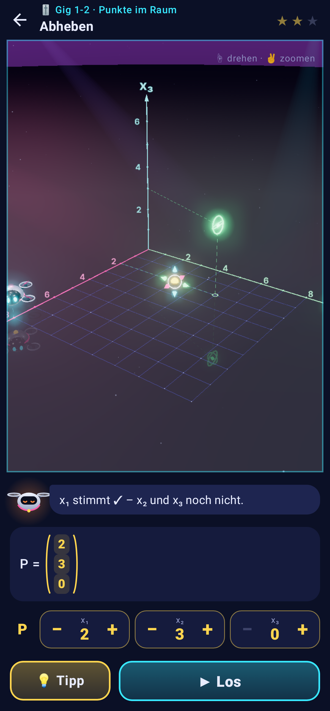 |  |  |
|  |  |  |
| 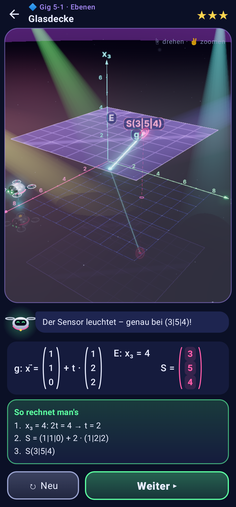 |  |  |
|  |  |  |
|  |  | 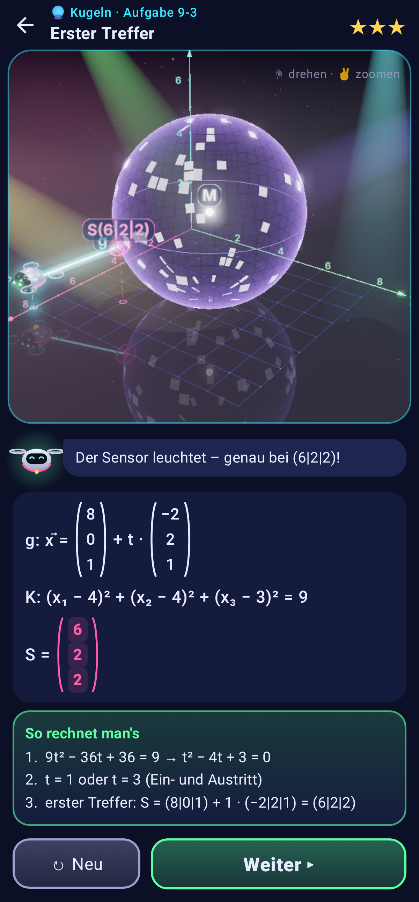 |
|  |  | 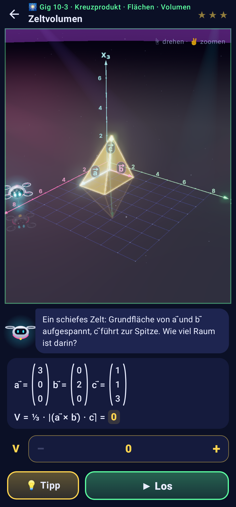 |
|  | 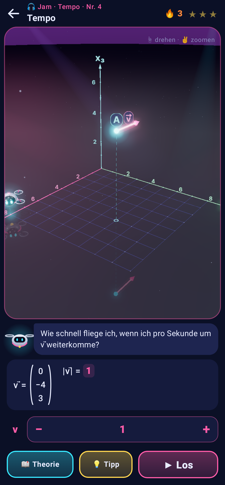 | 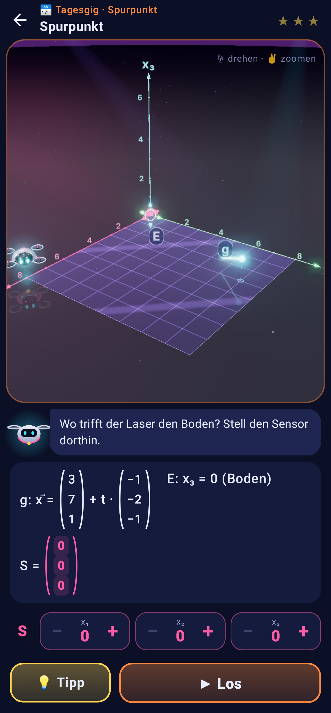 |
|  |  |  |
| 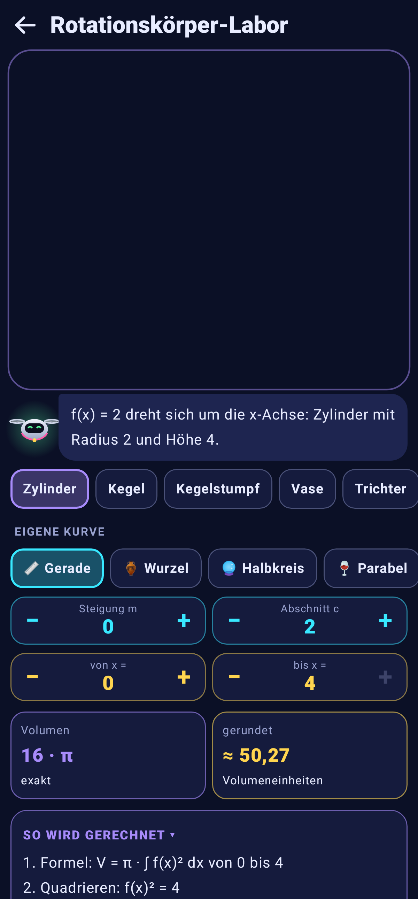 | 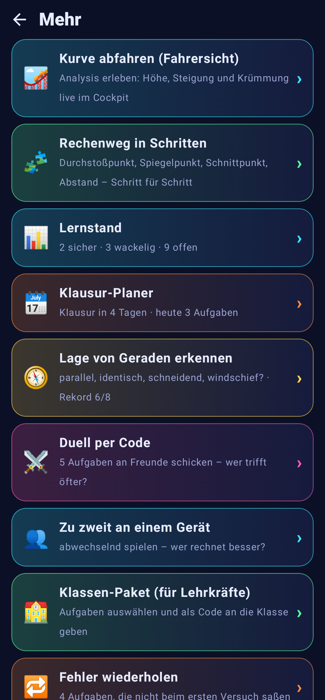 | 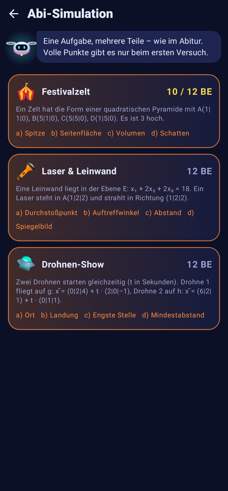 |
|  | 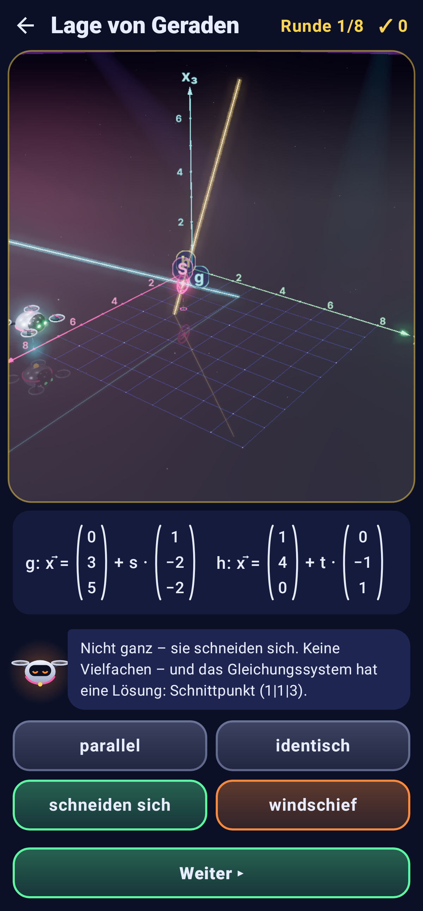 |  |
|  |  | 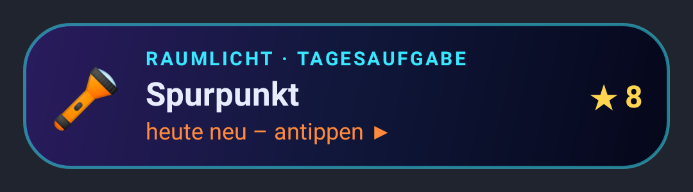 |
| 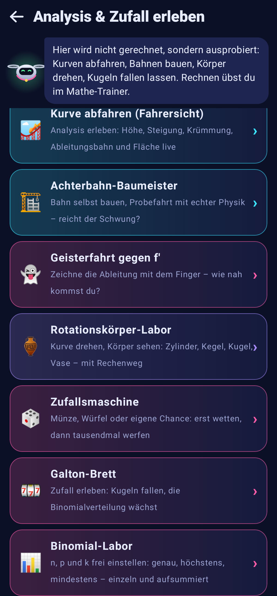 | | |
|  |  |  |
| 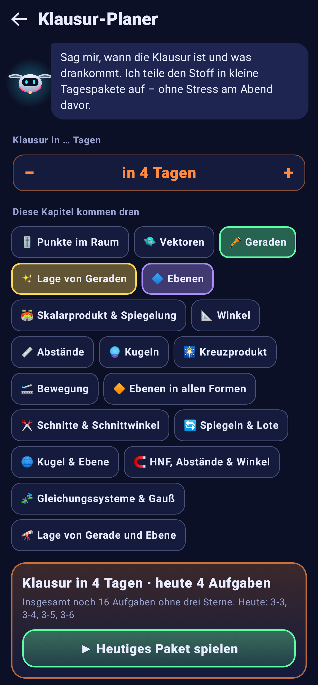 |  |  |
|  |  | |

| 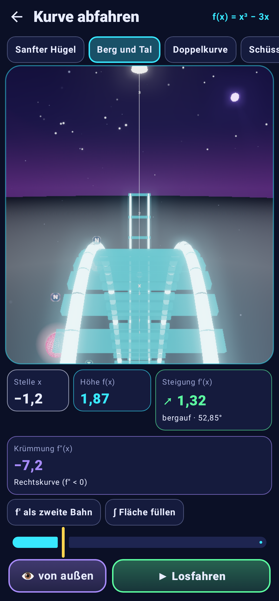 | 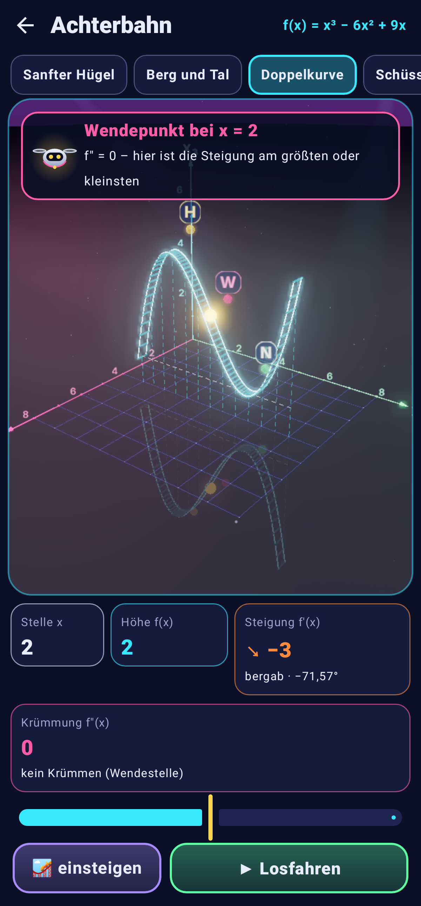 | |

|  |  | |
| 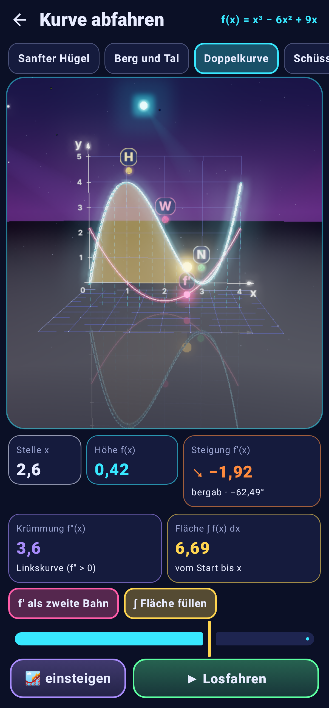 |  |  |
|  | 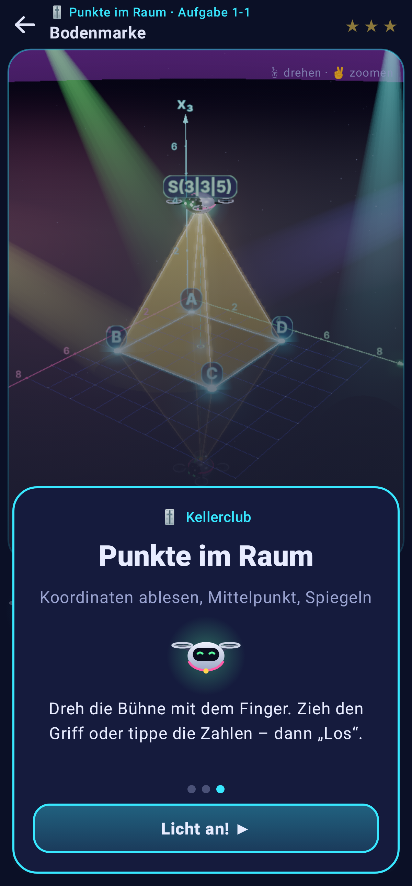 |  |

Seit 0.6.0: eigene Funktionen in „Kurve abfahren“ (`Expr` liest den Term, `Coaster.custom` baut Bahn, Maßstab und besondere Stellen).

| 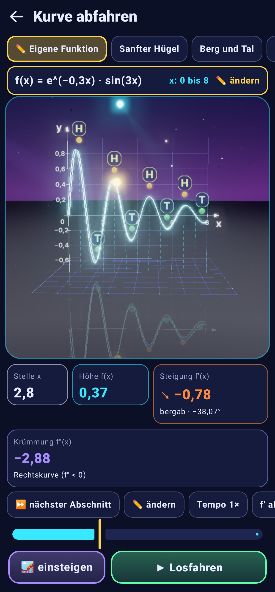 | 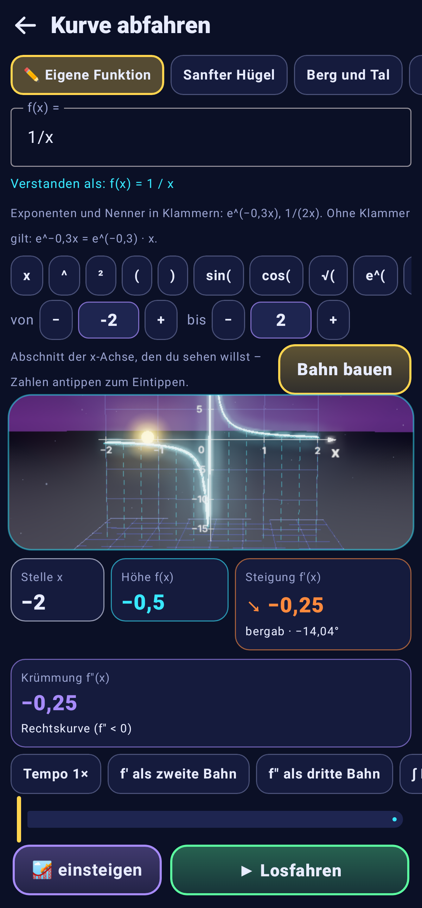 |
|---|---|

**KI-Tutor (ab 2.18.13, seit 2.18.15 für alle sichtbar):** Nach einem Fehlversuch erklärt Lux die Aufgabe mit KI-Hilfe anders und beantwortet Rückfragen. 3 Proben frei, danach „Raumlicht KI-Abi-Pass“
(10 KI-Punkte am Tag bis zum 31. Juli des Abi-Jahres). Die Server-Seite liegt als fertige Funktion in [`server/raumlicht-ki.js`](server/raumlicht-ki.js) (Prüfung: `node --test server/raumlicht-ki.test.js`).

| „Erklär’s mir anders“ mit Rückfrage | Seite zum KI-Abi-Pass |
|---|---|
| 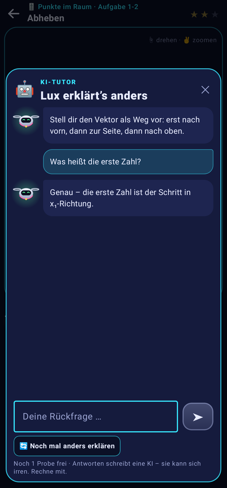 | 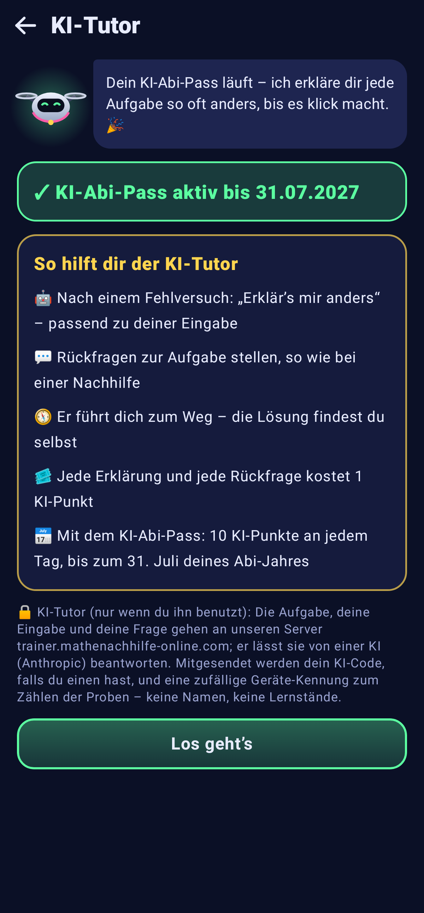 |

## WebApp (seit 2.5.0 vom 16.11.2026 mit der ganzen App)

Raumlicht entsteht für Android und Web aus einer Codebasis (Compose Multiplatform, Kotlin/Wasm):
- `core/model` ist ein Multiplattform-Modul – dieselbe Rechenlogik für beide.
- `shared` enthält alle Bildschirme und den App-Rahmen (`AppRoot`, eigene Navigation) – Android und Web zeigen denselben Code.
- `web/` ist die WebApp: nur noch die Browser-Seite (Speicher, Ton, Stimme, Teilen, Zurück-Taste, Schriften); sie bindet dieselbe 3D-Bühne ein (`app/src/main/assets/scene/scene.js`) und liest die Version aus `app/build.gradle.kts`.
- Bauen: `./gradlew :web:webapp` legt die fertigen Dateien nach `webapp/`. Prüfen: `cd webapp && python3 -m http.server 8765`, dann
  `cd scene && node test/web.mjs http://localhost:8765/ <Ordner für Bilder>` (Start, Bühne, Aufgabe lösen, Speicher, Version, Manifest, Konsolenfehler).
- Automatisches Update ohne Knopf (Service Worker + Selbst-Neuladen an ruhiger Stelle): `cd scene && node test/web-update.mjs ../webapp` stellt einen
  Versionswechsel nach und prüft Update, Speicher und Offline-Start. Nach jeder Änderung an `index.html` oder `sw.js` laufen lassen.
- Ausliefern: Der Workflow `.github/workflows/raumlicht-web-test.yml` spult den Branch `raumlicht-test` nach jedem Push auf den Standard-Branch vor,
  der `raumlicht/webapp/` ändert (prüft vorher Vollständigkeit, Dateitypen und gleiche Version wie die Android-App). Der Server holt den Branch;
  `raumlicht-live` setzt nur der Leitstand. Meldungen: `MELDUNG_AN_LEITSTAND.md`.
- 3D-Bühne im Browser: Das iframe liegt **unter** der Oberfläche; `Stage.wasmJs.kt` lässt dort ein durchsichtiges Fenster und reicht Zeiger und Mausrad
  an die Bühne weiter. So liegen Einblendungen und Konfetti wie unter Android über der Bühne.
- Hinweis Schriften: siehe unten „WebApp: Start, Schriften, Messen“.
- Stand: Web = Android bis auf Widgets, Erfolgskarte als Bild und den In-App-Updater (im Web unnötig).

**Bedien-Test der echten Bühne** (seit 2.3.1): `cd scene && node test/interact.mjs ../core/model/build/scenes.json` spielt Antippen, Ziehen und Wischen mit echten
Zeiger-Ereignissen im Browser durch und prüft, was die Bühne meldet. Vor jeder Auslieferung laufen lassen, wenn sich an der Bedienung der Bühne etwas ändert –
die Robolectric-Tests ersetzen die Bühne durch eine Attrappe und sehen solche Fehler nicht.

Querformat: 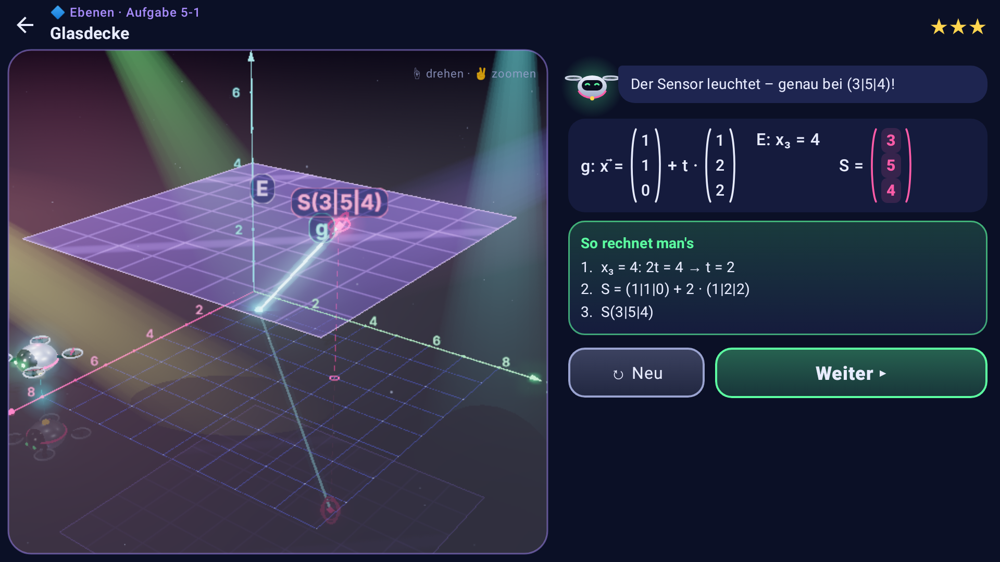

## Aufbau
- `core/model` – reine Kotlin-Logik: Vektorrechnung (`Geo`), Spielarten (`Families`), alle Level (`Levels`, `MoreLevels`), Aufgaben-Generator,
  Tagesaufgabe, Erfolge und Formelsammlung (`Gen.kt`), Abi-Prüfungsaufgaben, Lage von Geraden, Duell- und Show-Codes (`Modes.kt`), Bühnen-Beschreibung (`Stage`),
  Musik, Update-Prüfung. Tests spielen jedes Level mit seiner Lösung durch und rechnen die Mathematik unabhängig nach.
- `core/data` – Fortschritt (Room, Sterne sinken nie), Einstellungen
- `app` – Compose-Oberfläche, Lux, im Code erzeugte Geräusche, Updater. Die 3D-Bühne läuft in einem WebView
  (`app/src/main/assets/scene/`, komplett offline) und wird über `StageController` ferngesteuert.
- `scene` – Quelltext der 3D-Bühne (three.js): Spiegelboden, Leuchten (Bloom), Glas-Ebenen, Laser, Partikel, Lux als 3D-Modell.
  Die Bühne zeichnet nur; gerechnet und geprüft wird in `core/model`.

## Bauen & Ausliefern
```
export ANDROID_HOME=/opt/android-sdk
./gradlew test            # Tests + Bildschirmfotos (screenshots/)
./gradlew assembleGithubRelease   # APK für GitHub; Store-Paket: ./gradlew bundlePlayRelease (siehe STORE-RELEASE.md)
```
Nach Änderungen an der 3D-Bühne (`scene/src/main.js`):
```
cd scene && npm install && npm run build     # schreibt app/src/main/assets/scene/scene.js (wird mit eingecheckt)
../gradlew -p .. :core:model:test            # schreibt core/model/build/scenes.json
node test/shot.mjs ../core/model/build/scenes.json ../app/src/test/resources/stage 384 480   # optional: Muster als 6. Angabe, z. B. '^9-'
```
Der letzte Schritt rendert die 3D-Bilder, die in den Bildschirmfoto-Tests an Stelle der Bühne stehen (Robolectric kann kein WebGL).

Ausliefern: `versionCode`/`versionName` und `VERSION_DATE` in `app/build.gradle.kts` setzen, Abschnitt mit Datum in `CHANGELOG.md`, pushen.
GitHub baut, signiert (gleicher Schlüssel wie der Wissensgarten) und veröffentlicht `raumlicht-v<Version>` unter Releases.
Die App findet die neue Version selbst (Einstellungen → App-Update).

## Eltern-Handy koppeln, Lehrplan, Prüfplan (seit 2.18.26)

Freiwilliger, Ende-zu-Ende verschlüsselter Eltern-Bericht (`core/model/…/Eltern.kt`, QR-Code aus `Qr.kt`, Verschlüsselung im Browser). Was als Nächstes gebaut wird, steht in `LEHRPLAN-ABGLEICH.md`; wann was geprüft wird, in `PRUEFPLAN.md`; welche Formel zu welcher Aufgabe gehört, in `THEORIE-PRUEFLISTE.md`.

| Eltern-Handy koppeln | „Kommt bald“ |
|---|---|
| 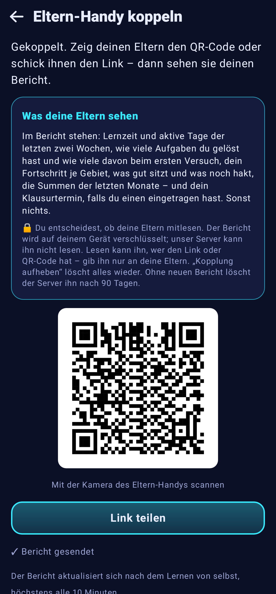 | 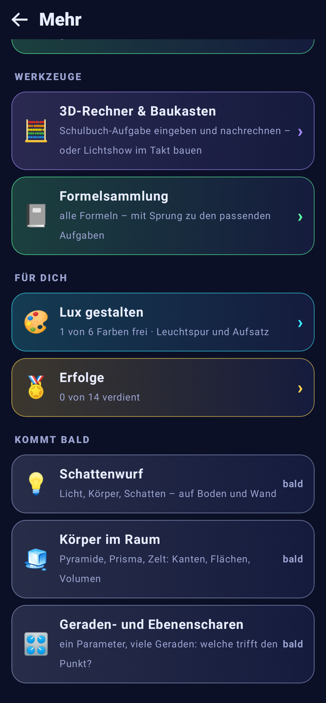 |
| 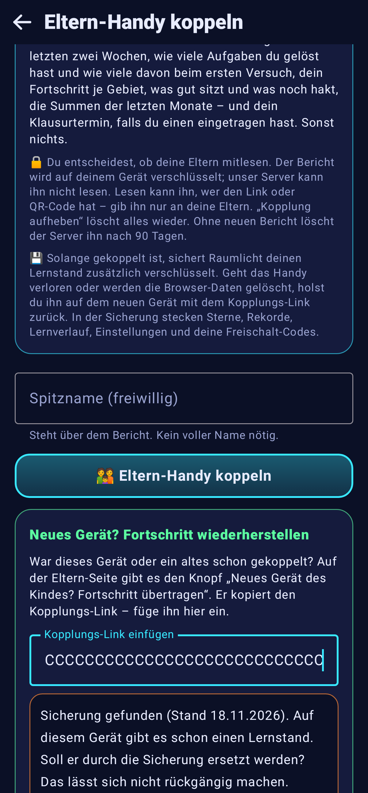 | |

**Am PC (seit 2.18.29):** Die Startseite teilt sich auf breiten Bildschirmen auf – links die Bühne, rechts Gebiete, Kapitel und Aufgaben.

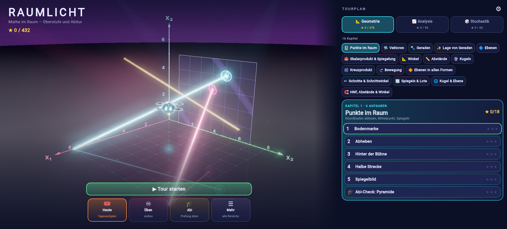

**„← Alle Apps“ (seit 2.18.31):** oben auf der Startseite, zurück zur App-Auswahl der Website.

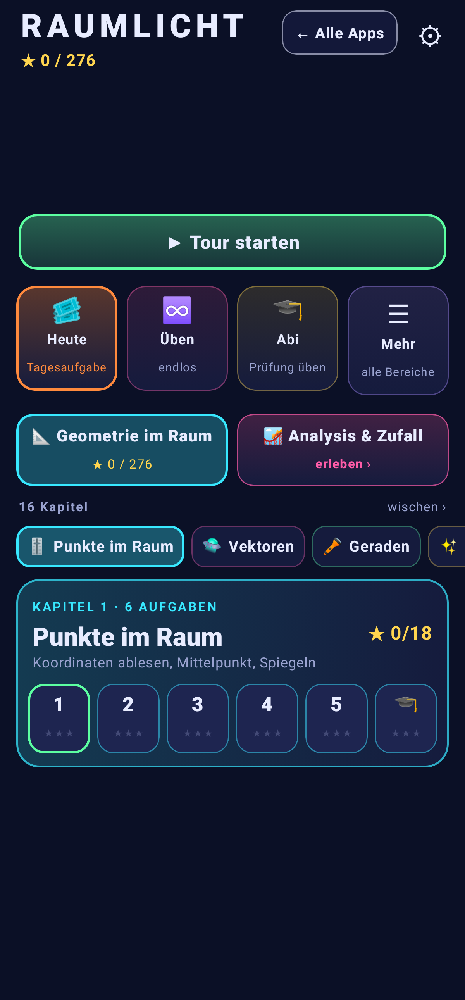

## Zählung, Nachhilfe-Hinweis, Geschenk (seit 2.18.22)

Anonyme Nutzungszählung (`Zaehler`), sachlicher Nachhilfe-Hinweis im Lernstand (`Nachhilfe`), Eintrag „Lern-Geschenk verschenken“ und Absender-Zeile – beide Schalter in den Einstellungen, alles in `core/model/…/Nachhilfe.kt`.

| Hinweis im Lernstand | Schalter in den Einstellungen |
|---|---|
| 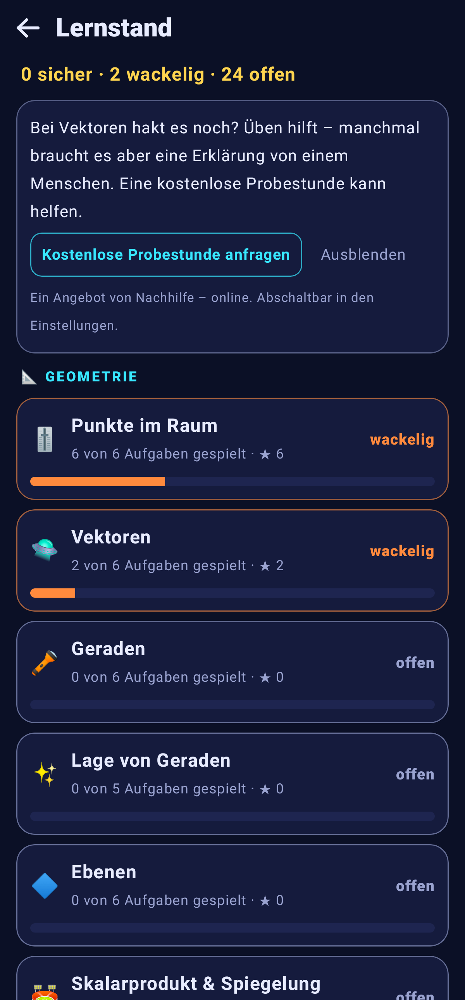 | 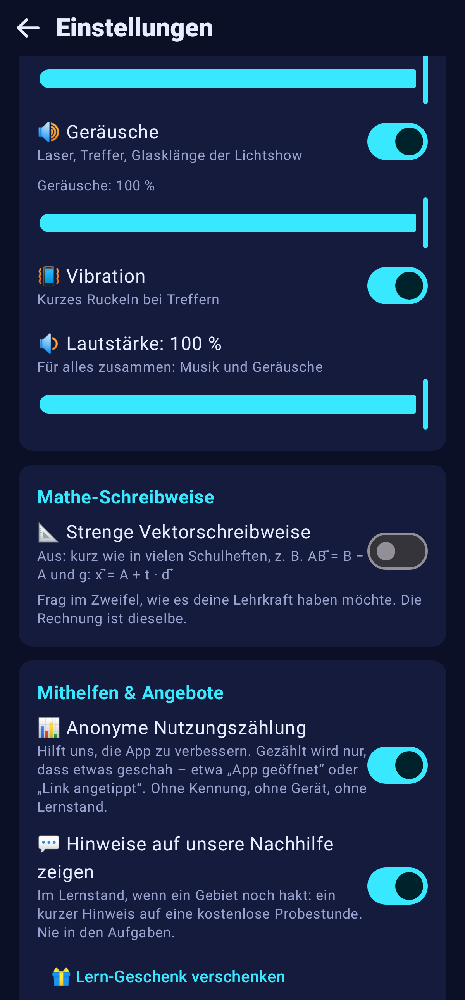 |

## Zwei Web-Fassungen: Wasm und JavaScript (seit 2.18.21)

Safari 26/27 zeigt mit der Kotlin/Wasm-Fassung eine weiße Seite. Darum baut `./gradlew :web:webapp` zwei Pakete aus denselben Quelltexten: `raumlicht.js` + Kern-`.wasm` (Kotlin/Wasm) und `raumlicht-js.js` (Kotlin/JS).
Die Startseite wählt (`modus=auto`): WebKit/Safari, Browser ohne WebAssembly-GC und Geräte, auf denen die Wasm-Fassung nicht startet, bekommen die JavaScript-Fassung. Von Hand: `?modus=js`, `?modus=wasm`; Schritte des Starts: `?diag=1`.
Die JS-Quelltexte erzeugt `tools/webjs/gen.py` beim Bau aus `src/wasmJsMain` (nur die eingebetteten `js("…")`-Schnipsel werden umgesetzt). Prüfung: `node scene/test/web-modus.mjs webapp <Bilder>`.

## Vorlesen mit „Nova“ (seit 2.17.0)

> **Seit 2.18.14 abgeschaltet** (`Vorlesen.ENABLED = false`): kein Schalter in den Einstellungen, keine Abrufe am Stimmen-Server, `texte.json` wird leer ausgeliefert. Der Code bleibt; das Folgende gilt wieder, sobald der Schalter auf `true` steht.

Lux liest mit der KI-generierten Stimme „Nova“ vor. Die App rechnet nichts: Zu jedem vorlesefertigen Text liegt auf unserem Server eine MP3-Datei.
`./gradlew :web:webapp` erzeugt dafür `webapp/vorlesen/texte.json` (alle festen Texte, Quelle `core/model/…/Vorlesen.kt`); der Server holt die Liste und vertont Neues vorab.
Texte, die erst in der Aufgabe entstehen, lässt die App über den Server erzeugen. Einzelheiten: `VORLESEN_FUER_ANDERE_APPS.md`.

## Zwei Fassungen: GitHub und Play Store

> **Pause seit 18.11.2026:** Vorerst wird nur die WebApp ausgeliefert (installierbar über „App installieren“ in den Einstellungen). Der Android-Code bleibt, der Release-Ablauf baut und veröffentlicht keine APK (`APK_AUSLIEFERN: "false"` in `.github/workflows/raumlicht-release.yml`).

`github` (APK, eigener Updater) und `play` (AAB, Updates über den Store, keine Installations-Berechtigung) – siehe `STORE-RELEASE.md`.
Tests: `./gradlew :core:model:jvmTest :app:testGithubDebugUnitTest`.

## WebApp: Start, Schriften, Messen (seit 2.9.0)

- **Ladebild und Ladeplan:** `web/src/wasmJsMain/resources/index.html` zeigt sofort ein Ladebild (reines HTML/CSS) und fordert App-Kern (.wasm) und Schriften gleich an;
  der Bau (`:web:webapp`) trägt Dateigrößen (`@LADEPLAN@`) und .wasm-Namen (`@WASM@` in `sw.js`) ein. Die 3D-Bühne wird erst danach geladen.
- **Schriften kürzen – automatisch:** Vor jedem `:web:webapp` läuft `:web:schriften` (`tools/schrift/schriften.py`, braucht `pip install fonttools`) und schreibt die Schriften
  mit genau den benutzten Zeichen neu. Ein neues Emoji im Text ist damit beim nächsten Bau dabei. Zusätzlich prüft der GitHub-Lauf „Raumlicht WebApp → Test“
  mit `--pruefen`, dass nichts fehlt – sonst geht die WebApp nicht auf die Testadresse. Die vollständigen Schriften liegen in `tools/schrift/quelle/`.
- **Start messen:** `cd scene && node test/web-speed.mjs ../webapp` – erster und zweiter Start bei „Fast 4G“ und „Slow 4G“ (der Testserver bremst selbst und zählt die Bytes).
  Mit `alles-komprimiert` als zweitem Wort zeigt es, was volle Komprimierung am Server bringen würde.
