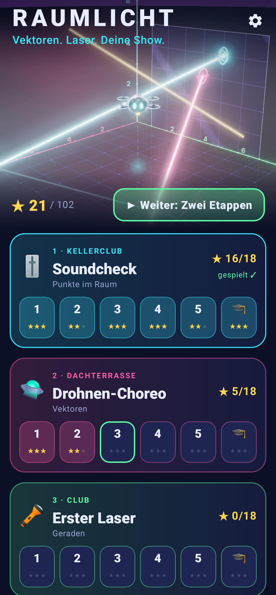
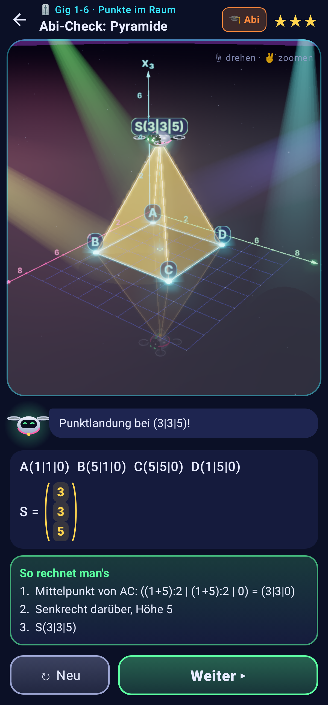
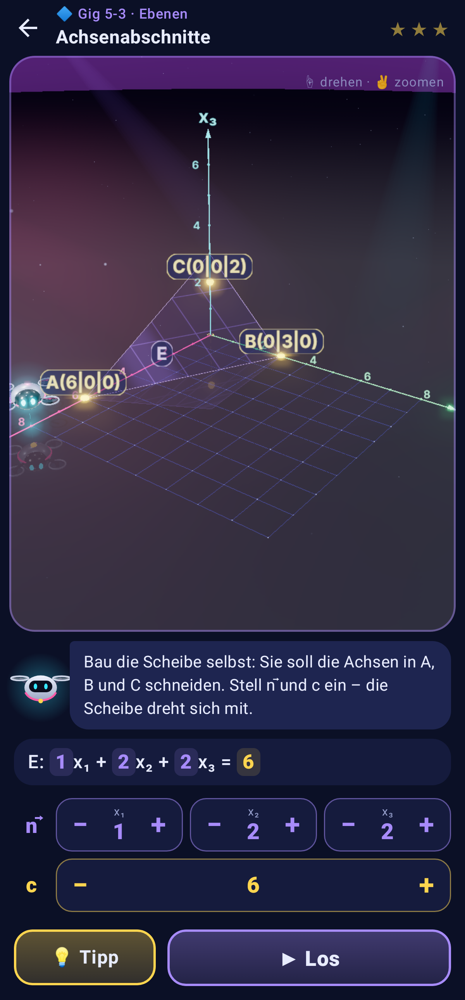
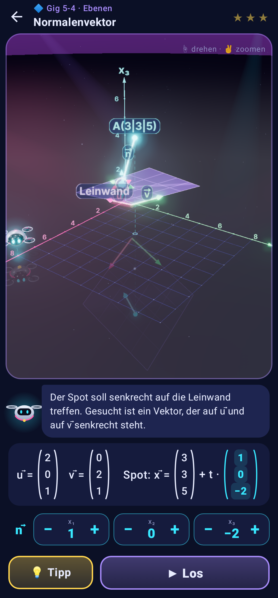

# Raumlicht – analytische Geometrie als Lichtshow (Oberstufe, ab Klasse 11)

Du bist Lichtdesigner:in. Laser sind Geraden, Glasscheiben und Leinwände sind Ebenen, die Drohne **Lux** fliegt deine Vektoren.
Die Bühne ist echtes 3D: drehen, zoomen, Punkte und Vektoren direkt im Raum ziehen. Das Rechnen ist die Spielhandlung selbst –
man sieht nur den Anfang eines Strahls, den Rest verrät die Rechnung (Recherche: `../docs/RECHERCHE.md`).

**34 Gigs in 6 Kapiteln**, jedes endet mit einem Abi-Check:

| Kapitel | Thema | Spielarten |
|---|---|---|
| 1 Soundcheck | Punkte im Raum | Koordinaten ablesen, Mittelpunkt, Spiegelung an Koordinatenebene, Pyramidenspitze |
| 2 Drohnen-Choreo | Vektoren | Verbindungsvektor, Vektorkette, Vielfaches, Parallelogramm, Schwerpunkt |
| 3 Erster Laser | Geraden | Richtungsvektor, Parameter t, Punktprobe, Spurpunkt |
| 4 Strahlen kreuzen | Lagebeziehungen | Schnittpunkt, parallel, windschief reparieren |
| 5 Glas & Leinwand | Ebenen | Durchstoßpunkt, Koordinatenform bauen, Normalenvektor, Schattenpunkt |
| 6 Headliner | Skalarprodukt · Abstand · Spiegelung | orthogonal, Lotfußpunkt, Spiegelpunkt, Abstand Punkt–Ebene, Reflexion über Bande |

## So funktioniert Raumlicht
- Einstellen: Griff in der Bühne ziehen (Kugel = in der Bodenebene, Pfeile = entlang einer Achse) oder Zahlen mit −/+ tippen.
  Die Formel zeigt die Zahlen live, als Spaltenvektoren wie im Heft.
- „Los“: Lux fliegt bzw. der Laser feuert. Treffer beim ersten Versuch = 3 ⭐, beim zweiten 2 ⭐, danach 1 ⭐. Mit Tipp höchstens 2 ⭐.
- Lux gibt nach Fehlversuchen gezielte Rückmeldung („liegt auf g ✓, aber nicht in E ✗“), nach dem Lösen steht der Rechenweg da.
- Nichts ist gesperrt: Wer für die Klausur ein Thema braucht, springt direkt hin.

## Bildschirme
| | | |
|---|---|---|
|  |  |  |
|  |  |  |
|  |  |  |
|  |  |  |
|  |  |  |

## Aufbau
- `core/model` – reine Kotlin-Logik: Vektorrechnung (`Geo`), Spielarten (`Families`), alle Level (`Levels`), Bühnen-Beschreibung (`Stage`),
  Musik, Update-Prüfung. Tests spielen jedes Level mit seiner Lösung durch und rechnen die Mathematik unabhängig nach.
- `core/data` – Fortschritt (Room, Sterne sinken nie), Einstellungen
- `app` – Compose-Oberfläche, Lux, im Code erzeugte Geräusche, Updater. Die 3D-Bühne läuft in einem WebView
  (`app/src/main/assets/scene/`, komplett offline) und wird über `StageController` ferngesteuert.
- `scene` – Quelltext der 3D-Bühne (three.js): Spiegelboden, Leuchten (Bloom), Glas-Ebenen, Laser, Partikel, Lux als 3D-Modell.
  Die Bühne zeichnet nur; gerechnet und geprüft wird in `core/model`.

## Bauen & Ausliefern
```
export ANDROID_HOME=/opt/android-sdk
./gradlew test            # Tests + Bildschirmfotos (screenshots/)
./gradlew assembleRelease
```
Nach Änderungen an der 3D-Bühne (`scene/src/main.js`):
```
cd scene && npm install && npm run build     # schreibt app/src/main/assets/scene/scene.js (wird mit eingecheckt)
../gradlew -p .. :core:model:test            # schreibt core/model/build/scenes.json
node test/shot.mjs ../core/model/build/scenes.json ../app/src/test/resources/stage 384 480
```
Der letzte Schritt rendert die 3D-Bilder, die in den Bildschirmfoto-Tests an Stelle der Bühne stehen (Robolectric kann kein WebGL).

Ausliefern: `versionCode`/`versionName` in `app/build.gradle.kts` erhöhen, Abschnitt in `CHANGELOG.md`, pushen.
GitHub baut, signiert (gleicher Schlüssel wie der Wissensgarten) und veröffentlicht `raumlicht-v<Version>` unter Releases.
Die App findet die neue Version selbst (Einstellungen → App-Update).
