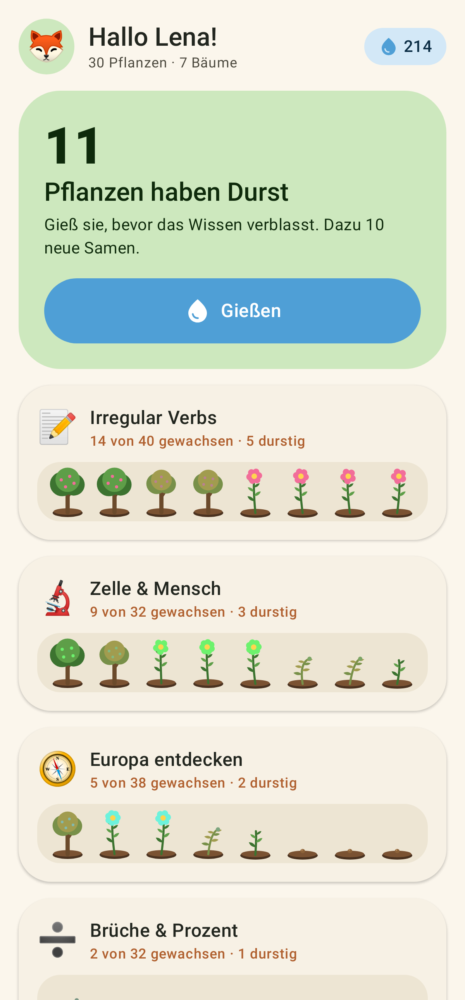
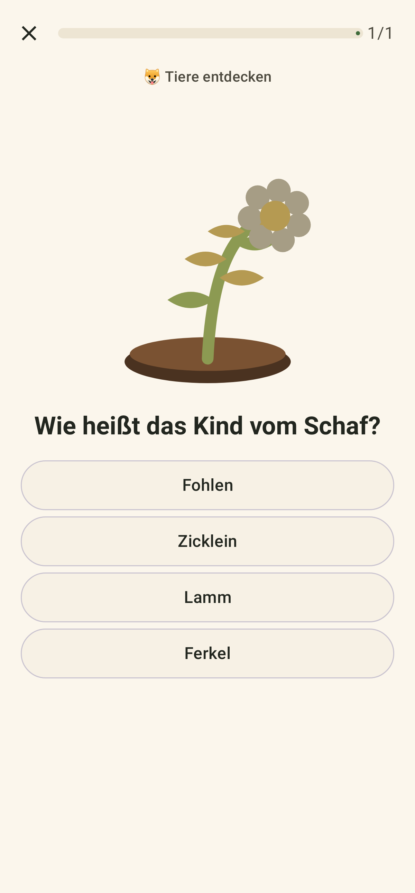
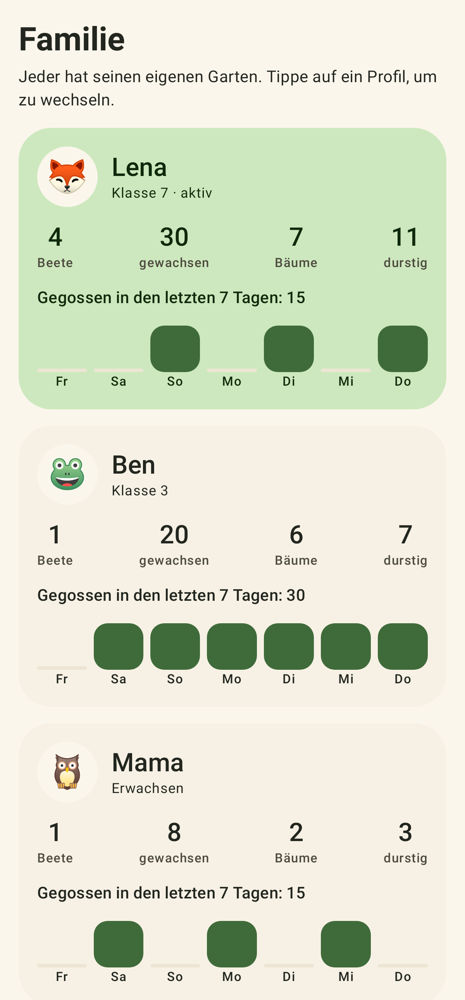

# Wissensgarten 🌱

Lernkarten als gemütliches Garten-Spiel – für die ganze Familie, von Klasse 1 bis zum Erwachsenen.
Jede Karte ist eine Pflanze: Sie wächst mit dem Wissen und welkt nach der Vergessenskurve.
Gießen = Wiederholen zum richtigen Zeitpunkt.

| Willkommen | Beete wählen | Anleitung | Garten | Beet |
| --- | --- | --- | --- | --- |
|  |  |  |  |  |

| Gießen (Auswahl) | Grundschule | Samenhandlung | Familie |
| --- | --- | --- | --- |
|  |  |  |  |

## Funktionen

- **Einrichtung**: Wer lernt (selbst / Kind), Name + Tier-Avatar, Klassenstufe, dann **beliebige Beete** wählen –
  die Stufe hebt nur passende Pakete hervor. Eigene Beete jederzeit möglich.
- **Interaktive Anleitung** mit Zeitraffer: Man sieht, wie Wissen welkt und Gießen hilft.
- **43 Wissenspakete, ~1500 Karten** von Grundschule bis Erwachsene (Mathe, Deutsch, Englisch, Französisch, Latein,
  Spanisch, Bio, Chemie, Physik, Informatik, Geschichte, Erdkunde, Politik, Wirtschaft, Musik, Allgemeinwissen, Erste Hilfe).
- **Auswahl-Aufgaben** (automatisch bewertet) und klassische Karten mit Selbsteinschätzung; Grundschüler bekommen nur
  „Wusste ich / Wusste ich nicht“.
- **Familie**: mehrere Profile auf einem Gerät, Wochen-Überblick für Eltern.
- **Samenhandlung**: alle Pakete nach Stufe und Fach filtern und pflanzen.
- **Widget** für den Startbildschirm, helles Design als Standard (Dunkel optional).

## Aufbau (Module)

| Modul | Inhalt |
| --- | --- |
| `core/model` | reine Kotlin-Logik ohne Android: Vergessenskurve (`Memory.kt`), Paketformat (`Pack.kt`), Gieß-Runden (`Session.kt`) |
| `core/data` | Room-Datenbank (Profile, Beete, Karten, Lernprotokoll), Paket-Katalog, Paket-Updates, Freischaltungen, Einstellungen |
| `content` | Wissenspakete als JSON – Format in [`content/PACK_FORMAT.md`](content/PACK_FORMAT.md) |
| `app` | Oberfläche (Compose), Navigation, Widget |

### Erweitern & Updates

- **Neues Paket**: JSON-Datei in `content/src/main/assets/packs/` – kein Code nötig. `PackValidationTest` prüft das Format.
- **Paket aktualisieren**: Inhalt ändern, `version` erhöhen. Beim nächsten Start bekommen alle, die das Beet gepflanzt
  haben, neue Karten dazu, Texte werden korrigiert – der Lernfortschritt bleibt (über die Karten-`id`).
- **Datenbank ändern**: Version in `GardenDatabase` erhöhen und Migration ergänzen; Schemata liegen in `core/data/schemas`.
- **Bezahlversion (später)**: Pakete mit `"tier": "plus"` sind markiert. `Entitlements`/`Monetization.ENFORCED` in
  `core/data` sind die einzige Stelle, an der Google Play Billing angeschlossen werden muss. Heute ist alles frei.

## Bauen & Testen

Benötigt JDK 17+ und Android SDK (Plattform 36).

```bash
./gradlew assembleRelease     # → app/build/outputs/apk/release/app-release.apk
./gradlew test                # Logik, Datenbank, Paket-Prüfung, Bildschirmfotos (→ screenshots/)
```

## Nächste Ideen

- Erinnerung per Benachrichtigung, wenn Pflanzen Durst haben
- Tautropfen gegen Pflanzenarten und Gartendeko eintauschen
- Pakete aus dem Internet nachladen; Karten-Sets teilen (Link/QR), CSV-Import
- Dungeon-Modus: gewachsene Pflanzen werden Kampfkarten
- Play Store: eigener Upload-Schlüssel, Datenschutzerklärung, Billing für „Plus“
