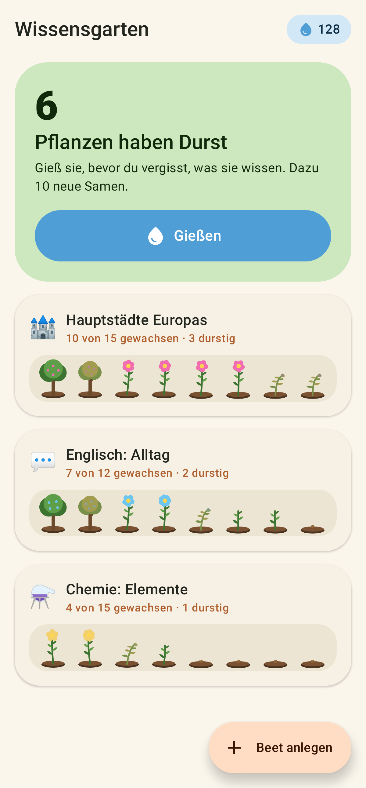
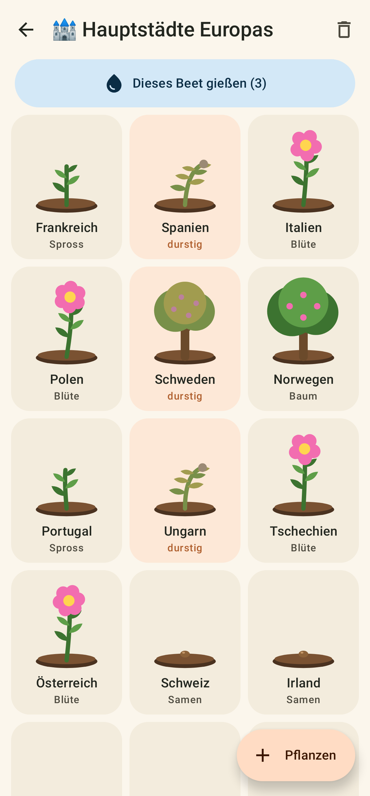
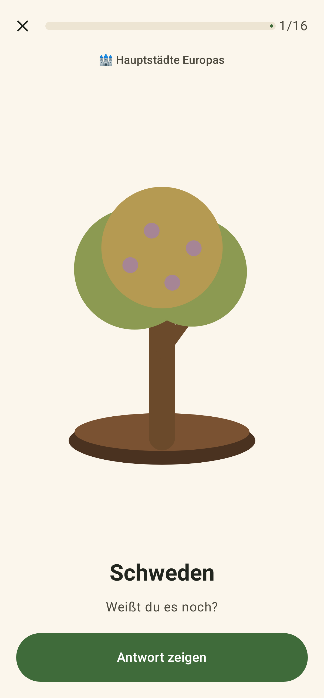
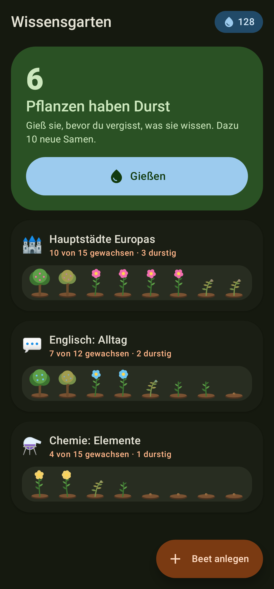

# Wissensgarten 🌱

Lernkarten als gemütliches Garten-Spiel. Jede Karte ist eine Pflanze.

- **Samen** ist eine neue Karte. Beim ersten Lernen keimt sie.
- **Wachsen:** Je länger du etwas behältst (Stabilität), desto größer wird die Pflanze:
  Keimling → Spross → Busch → Blüte → Baum.
- **Welken:** Die Pflanze welkt genau so, wie dein Gedächtnis nachlässt (Vergessenskurve nach dem FSRS-Modell).
  Sinkt die Erinnerung unter 90 %, hat die Pflanze **Durst**.
- **Gießen** heißt wiederholen. Es gibt keine Lernserie, die reißen kann, also keinen Stress.
  Für jede gegossene Pflanze gibt es Tautropfen.
- **Widget** auf dem Startbildschirm: zeigt, wie viele Pflanzen durstig sind. Antippen startet sofort das Gießen.

| Garten | Beet | Gießen | Dunkel |
| --- | --- | --- | --- |
|  |  |  |  |

## Bauen

Benötigt JDK 17+ und das Android SDK (Plattform 36).

```bash
./gradlew assembleRelease       # → app/build/outputs/apk/release/app-release.apk
./gradlew testDebugUnitTest     # Logik-Tests + Bildschirmfotos nach screenshots/
```

Die Bildschirmfotos entstehen ohne Emulator über Robolectric und Roborazzi (`ScreenshotTest`).

## Aufbau

| Datei | Inhalt |
| --- | --- |
| `data/Scheduler.kt` | Vergessenskurve, Wachstum, Welke |
| `data/GardenRepository.kt` | Speichern als JSON, Gieß-Runde (durstige zuerst, max. 10 neue Samen pro Tag) |
| `data/StarterBeds.kt` | Start-Beete: Hauptstädte, Englisch, Chemie |
| `ui/Plant.kt` | Pflanzen werden komplett per Code gezeichnet (keine Bilddateien) |
| `ui/GardenScreen.kt`, `BedScreen.kt`, `ReviewScreen.kt` | Bildschirme |
| `widget/GardenWidget.kt` | Startbildschirm-Widget (Glance) |

## Nächste Ideen

- Erinnerung per Benachrichtigung, wenn Pflanzen Durst haben
- Tautropfen gegen neue Pflanzenarten und Gartendeko eintauschen
- Karten-Sets teilen (Link / QR-Code) und als CSV importieren
- Dungeon-Modus: Gewachsene Pflanzen werden Kampfkarten in einem kurzen Roguelike
- Eigener Upload-Schlüssel für den Play Store (aktuell mit Debug-Schlüssel signiert)
